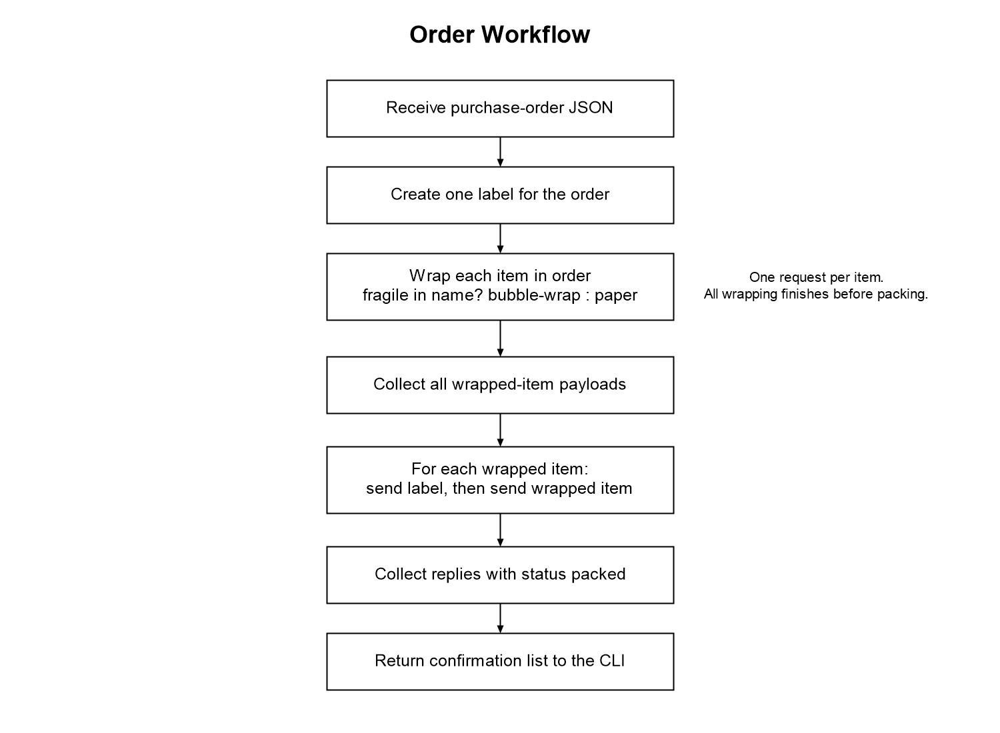
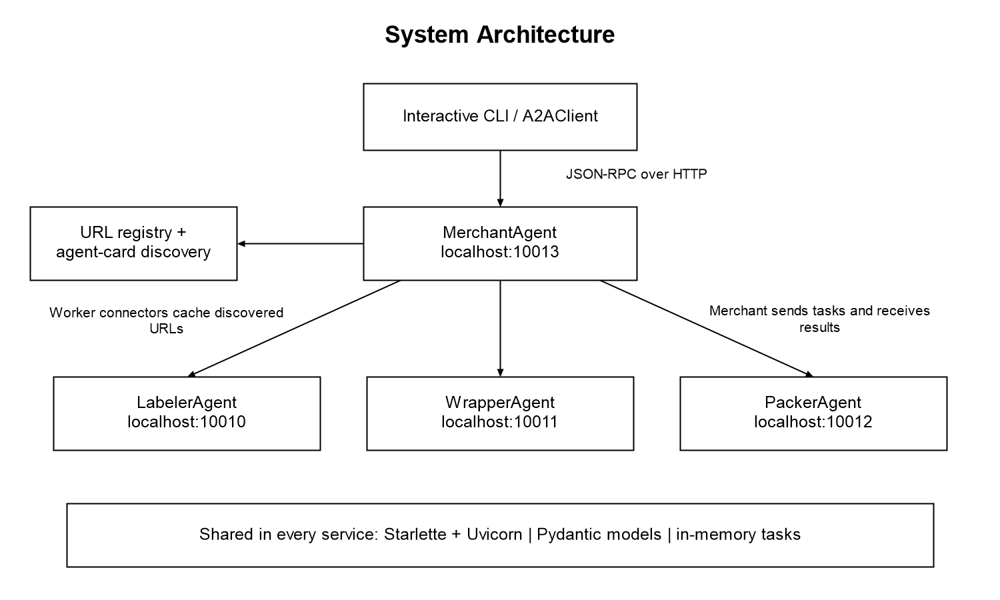
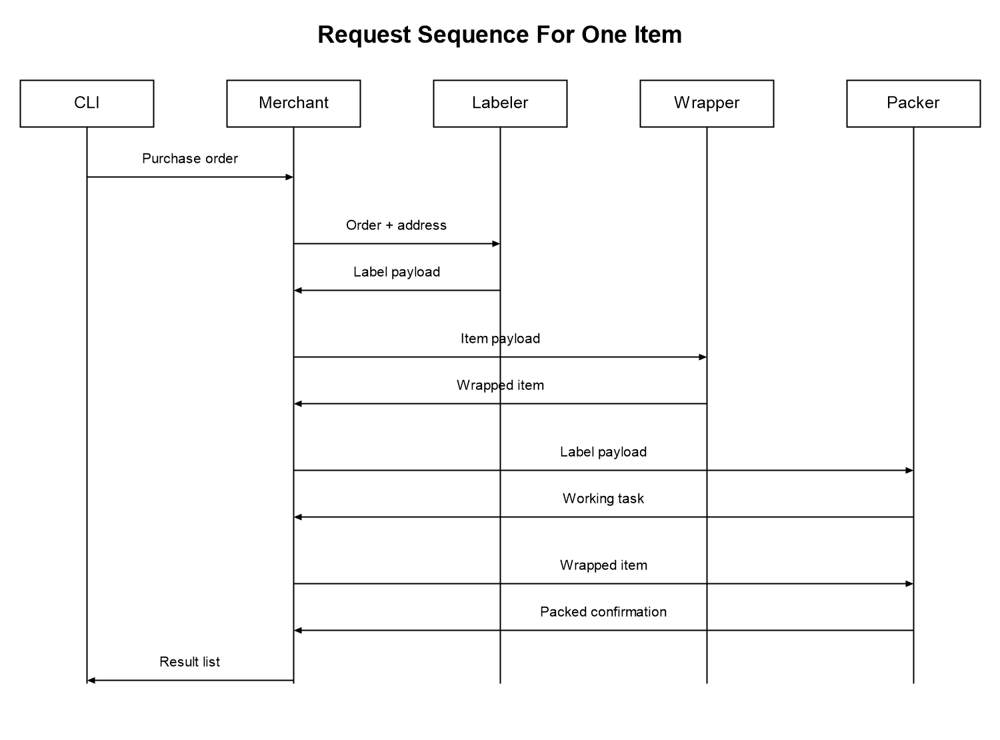
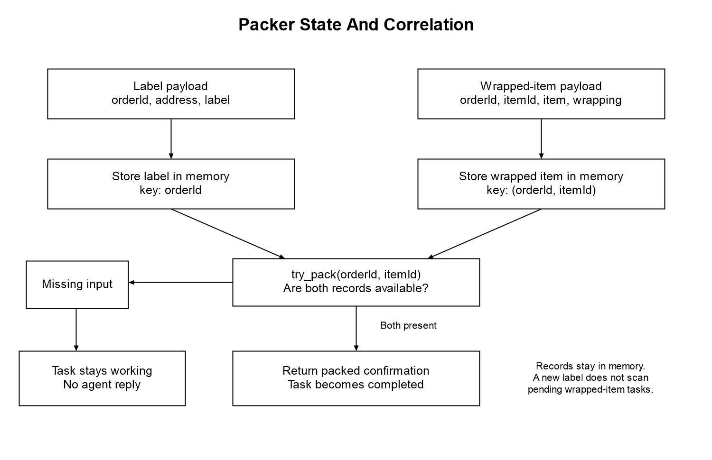
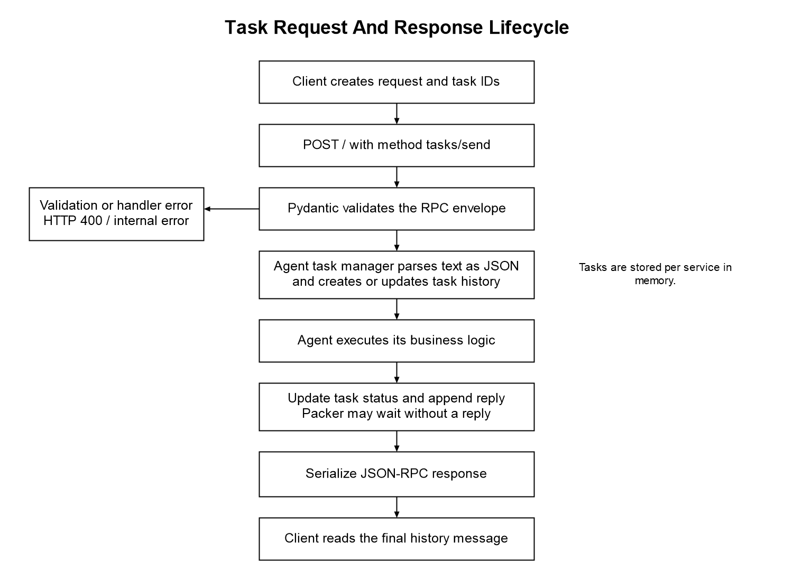

# Conceptual A2A Model

I built this project to demonstrate how independent agents can coordinate a simple order-fulfilment workflow. A merchant agent receives a purchase order, asks a labeller for a shipping label, sends each item to a wrapper, and collects packing confirmations from a packer. Each agent runs as its own local HTTP service.

The implementation uses Python, asynchronous HTTP requests, JSON-RPC 2.0 messages, and discoverable agent cards. The business logic is deterministic. Running the order workflow does not require an AI model, API key, cloud account, or database.

## Table of Contents

- [What The Project Does](#what-the-project-does)
- [Architecture](#architecture)
- [Requirements and Downloads](#requirements-and-downloads)
- [Installation](#installation)
- [Start The Agents](#start-the-agents)
- [Run A Purchase Order](#run-a-purchase-order)
- [Input And Output Reference](#input-and-output-reference)
- [HTTP And Task Protocol](#http-and-task-protocol)
- [Discovery And Configuration](#discovery-and-configuration)
- [Code Guide](#code-guide)
- [Troubleshooting](#troubleshooting)
- [Stop and Restart](#stop-and-restart)

## What The Project Does

I use four agents to keep each responsibility small and visible.

| Agent | Default Port | Responsibility |
| --- | --- | --- |
| LabelerAgent | 10010 | Creates a label string from the order ID and current local timestamp |
| WrapperAgent | 10011 | Chooses `bubble-wrap` when the item name contains `fragile`, ignoring case, and `paper` otherwise |
| PackerAgent | 10012 | Stores labels and wrapped items in memory and returns a confirmation when both are available |
| MerchantAgent | 10013 | Coordinates the other agents and returns a list of packed items |

A label is a generated identifier, not a printable postage label. Wrapping and packing are simulated data transformations. There is no payment processing, stock management, shipping-provider integration, or physical packing.



For an order with N items, the merchant makes one label request, N wrapping requests, and 2N packer requests. It sends the same label to the packer before each wrapped item. These requests run sequentially.

## Architecture

I separate transport, task handling, and business logic. Every agent uses the shared Starlette server and Pydantic message models. Uvicorn serves each process, and HTTPX carries requests between processes.



The merchant discovers workers from a local registry of URLs. It fetches their agent cards, matches the exact agent names, and caches a connector for each worker. The CLI connects directly to the merchant URL.



The sequence repeats the wrapping exchange for every item before the merchant starts sending items to the packer. The diagram shows the exchanges for one item.

## Requirements and Downloads

I use Python 3.11 for the setup below:

| Requirement | How to obtain it | Purpose |
| --- | --- | --- |
| Git | [Official Git downloads](https://git-scm.com/downloads) | Clone the repository. Optional if downloading a ZIP |
| uv | [Official uv installation guide](https://docs.astral.sh/uv/getting-started/installation/) | Download Python and install the locked dependencies |
| Python 3.11 | Install through uv below, or use [Python downloads](https://www.python.org/downloads/) | Execute the application |
| Five terminal sessions | PowerShell, Terminal, or another terminal application | Run four services and one client |
| Internet access during setup | Access to the Python and package download services | Download the interpreter and dependencies |

The running demo uses localhost ports 10010 through 10013. Keep these ports available. After setup, the order workflow communicates locally.

### Install uv On Windows

Open PowerShell and run the installer from the [uv installation guide](https://docs.astral.sh/uv/getting-started/installation/).

```powershell
powershell -ExecutionPolicy ByPass -c "irm https://astral.sh/uv/install.ps1 | iex"
```

Close and reopen PowerShell so that the updated PATH is available, then check the installation.

```powershell
uv --version
```

### Install uv On macOS Or Linux

Use the shell installer documented in the same [official guide](https://docs.astral.sh/uv/getting-started/installation/).

```sh
curl -LsSf https://astral.sh/uv/install.sh | sh
```

Restart the terminal, then run `uv --version`. Install Git through its official download page or the operating system's package manager if needed.

## Installation

### 1. Download The Repository

```sh
git clone https://github.com/sahasatyaki/Conceptual-A2A-Model.git
cd Conceptual-A2A-Model
cd vs1
```

Alternatively, use **Code > Download ZIP** on the repository page, extract the archive, and open a terminal inside its `vs1` folder.

All application commands below run from `Conceptual-A2A-Model/vs1`.

### 2. Install Python and Dependencies

```sh
uv python install 3.11
uv sync --locked --python 3.11
```

This creates `vs1/.venv` and installs the dependency versions selected by `vs1/uv.lock`. Virtual-environment activation is unnecessary when using `uv run`. The [uv project guide](https://docs.astral.sh/uv/guides/projects/) explains the environment and lockfile workflow.

Use the full locked dependency set for this setup. `server/server.py` imports FastAPI's JSON encoder, and FastAPI is supplied through the locked `google-adk` dependency. Installing only Starlette and Uvicorn is insufficient.

The main declared dependencies are:

| Package | Declared Minimum | Role In This Repository |
| --- | --- | --- |
| asyncclick | 8.1.8 | Asynchronous interactive CLI |
| click | 8.1.8 | Agent host and port options |
| google-adk | 1.0.0 | Declared dependency, also brings in FastAPI through the lockfile |
| httpx | 0.28.1 | Agent discovery and task HTTP requests |
| httpx-sse | 0.4.0 | Imported by the client, streaming is not implemented |
| pydantic | 2.11.3 | Request, response, task, and agent-card models |
| starlette | 0.46.2 | HTTP application and routes |
| uvicorn | 0.34.2 | HTTP server process |

The minimum versions are listed in `pyproject.toml`. The lockfile determines the actual installed versions.

### 3. Create The Agent Registry

On Windows PowerShell:

```powershell
Copy-Item utilities/a2a/agent_registry.example.json utilities/a2a/agent_registry.json
```

On macOS or Linux:

```sh
cp utilities/a2a/agent_registry.example.json utilities/a2a/agent_registry.json
```

The resulting file should contain:

```json
[
  "http://localhost:10010",
  "http://localhost:10011",
  "http://localhost:10012",
  "http://localhost:10013"
]
```

The real registry is ignored by Git. Create it locally after each fresh clone.

### 4. Check Imports

```sh
uv run --locked python -c "import httpx, pydantic, starlette, uvicorn, fastapi, asyncclick"
```

No output indicates that these imports succeeded. Continue with the services below.

## Start The Agents

Open four terminals. In every terminal, change into the same repository's `vs1` directory. Run one command per terminal and leave it running.

| Terminal | Service | Command |
| --- | --- | --- |
| 1 | Labeller | `uv run --locked python -m agents.labeler_agent` |
| 2 | Wrapper | `uv run --locked python -m agents.wrapper_agent` |
| 3 | Packer | `uv run --locked python -m agents.packer_agent` |
| 4 | Merchant | `uv run --locked python -m agents.merchant_agent` |

Wait until each Uvicorn process reports that it is running. Start all four services before submitting an order.

### Check The Discovery Endpoints

Open these URLs in a browser. Each should return an agent-card JSON document.

- [Labeller card](http://localhost:10010/.well-known/agent.json)
- [Wrapper card](http://localhost:10011/.well-known/agent.json)
- [Packer card](http://localhost:10012/.well-known/agent.json)
- [Merchant card](http://localhost:10013/.well-known/agent.json)

Each card includes the agent's name, URL, version, capabilities, and skill. The root URL accepts POST requests, so opening just `http://localhost:10013/` in a browser is not a service check.

## Run A Purchase Order

### 1. Start The Client

Open a fifth terminal inside `vs1`.

```sh
uv run --locked python -m app.cmd.cmd --agent http://localhost:10013
```

Always pass `--agent` for this demo. The CLI defaults to port 10002, while the merchant listens on port 10013.

### 2. Paste An Order

At the prompt, paste this entire JSON object as one line and press Enter.

```json
{"orderId":"ORDER-001","address":"10 Example Road, London","items":[{"itemId":"ITEM-001","name":"Fragile glass vase"},{"itemId":"ITEM-002","name":"Notebook"}]}
```

The CLI accepts a line of text, but the merchant expects that text to be valid purchase-order JSON. Natural-language requests such as `pack my order` will fail.

### 3. Read The Result

The client prints the outgoing JSON-RPC request followed by `Agent says:` and a list resembling:

```json
[
  {
    "orderId": "ORDER-001",
    "itemId": "ITEM-001",
    "wrapping": "bubble-wrap",
    "label": "LABEL-ORDER-001-20261026120000",
    "status": "packed"
  },
  {
    "orderId": "ORDER-001",
    "itemId": "ITEM-002",
    "wrapping": "paper",
    "label": "LABEL-ORDER-001-20261026120000",
    "status": "packed"
  }
]
```

The timestamp above is illustrative. A real label uses the labeller's current local time in `YYYYMMDDHHMMSS` format. Both items share the order's label. UUIDs and task timestamps also change between runs.

For this example, check that two confirmations appear, the vase uses `bubble-wrap`, the notebook uses `paper`, and both statuses are `packed`. The service terminals print requests and logs during processing.

### 4. Optional CLI Flags

```sh
uv run --locked python -m app.cmd.cmd --agent http://localhost:10013 --history
uv run --locked python -m app.cmd.cmd --agent http://localhost:10013 --session 123
uv run --locked python -m app.cmd.cmd --help
```

Run these as separate client invocations. `--history` prints the returned task's messages. Every prompt creates a fresh task, so it does not print every earlier task from the interactive session. `--session 0`, the default, generates a UUID. Use an integer for a custom session value because the existing CLI option infers its type from the integer default.

Type `:q` or `quit` at the prompt to exit.

## Input And Output Reference

### Purchase-Order Input

| Field | Recommended Value | Meaning |
| --- | --- | --- |
| `orderId` | Nonempty, unique string | Identifies the order and is reused as the worker session ID |
| `address` | String | Returned by the labeller with the generated label |
| `items` | Array of item objects | Items processed in their input order |
| `items[].itemId` | Nonempty string, unique within the order | Correlates a wrapped item with its packing result |
| `items[].name` | String | Determines wrapping through a case-insensitive substring check |

The agents access dictionary keys directly. Missing fields and invalid types can raise errors. An empty `items` list returns an empty confirmation list after label creation and worker discovery.

Additional item fields pass through the wrapper's `item` object but do not appear in the final packing confirmation. One item object produces at most one collected confirmation.

### Intermediate Payloads

| Exchange | JSON Fields |
| --- | --- |
| Merchant to labeller | `orderId`, `address` |
| Labeller to merchant | `orderId`, `address`, `label` |
| Merchant to wrapper | `orderId`, `itemId`, `item` |
| Wrapper to merchant | `orderId`, `itemId`, `item`, `wrapping` |
| Merchant to packer | Label payload first, wrapped-item payload second, as separate tasks |
| Packer to merchant | `orderId`, `itemId`, `wrapping`, `label`, `status` when packing succeeds |

### How Packing State Works



The packer stores labels by `orderId` and wrapped items by `(orderId, itemId)`, guarded by an asynchronous lock. A label-only request normally remains `working` with no agent reply because it has no item ID. A subsequent wrapped-item request finds both records and completes with a confirmation.

Storing a label does not scan pending items or automatically finish their earlier tasks. The merchant avoids this issue by sending the label before every wrapped item. Records remain in memory after successful packing.

## HTTP And Task Protocol

The repository contains a small A2A-style transport.

| Endpoint or Method | Current Behaviour |
| --- | --- |
| `GET /.well-known/agent.json` | Returns an agent card |
| `POST /` with `tasks/send` | Validates the envelope and invokes the agent's task manager |
| `POST /` with `tasks/get` | Has models and helper code, but the HTTP server rejects it as unsupported |
| Streaming and push notifications | Disabled in the agent cards and not implemented |



The `text` field contains a JSON-encoded string. It must not contain an unencoded object. For example, this complete request can be sent to the merchant with any HTTP client that supports JSON POST requests:

```json
{
  "jsonrpc": "2.0",
  "id": "request-001",
  "method": "tasks/send",
  "params": {
    "id": "task-001",
    "sessionId": "session-001",
    "message": {
      "role": "user",
      "parts": [
        {
          "type": "text",
          "text": "{\"orderId\":\"ORDER-002\",\"address\":\"10 Example Road\",\"items\":[{\"itemId\":\"ITEM-001\",\"name\":\"Notebook\"}]}"
        }
      ]
    }
  }
}
```

Use `Content-Type: application/json` and POST to `http://localhost:10013/`. The outer `id` correlates the RPC request. `params.id` identifies the task. A successful result contains `id`, `status`, and `history`. The final agent message is available at `result.history[-1].parts[0].text` and contains the JSON-encoded result list.

The task models define several possible states. The standard labeller, wrapper, and merchant paths create a `submitted` task and then mark it `completed`. Packer tasks can remain `working` while an input is missing. Exceptions return HTTP 400 with an internal-error object. They do not consistently mark stored tasks as `failed`.

The HTTP client uses a 60-second request timeout. Discovery uses a 5-second timeout per registered URL.

## Discovery And Configuration

`vs1/utilities/a2a/agent_registry.json` must be a JSON list of base URLs. Discovery requests `/.well-known/agent.json` from each URL and skips endpoints that fail. The merchant looks for the exact names `LabelerAgent`, `WrapperAgent`, and `PackerAgent`.

Each agent supports `--host` and `--port`. For example, to move the labeller:

```sh
uv run --locked python -m agents.labeler_agent --host localhost --port 11010
```

Update its registry entry to `http://localhost:11010` and restart the merchant. If moving the merchant, also change the CLI's `--agent` URL. The discovery object loads the registry when constructed, and the merchant caches worker connectors. Restarting the merchant applies registry changes reliably.

Use addresses that are reachable from the process making the request. The launch arguments are also used to populate the card's advertised URL. The default localhost setup keeps this straightforward.

## Code Guide

The application lives under `vs1`. I use the following layout:

```text
Conceptual-A2A-Model/
|-- README.md
|-- LICENSE
|-- assets/
|   |-- architecture.png
|   |-- order-workflow.png
|   |-- request-sequence.png
|   |-- packer-state.png
|   `-- task-lifecycle.png
|-- sequence.mmd
|-- system_architecture.mmd
`-- vs1/
    |-- pyproject.toml
    |-- uv.lock
    |-- agents/
    |   |-- labeler_agent/
    |   |-- wrapper_agent/
    |   |-- packer_agent/
    |   `-- merchant_agent/
    |-- app/cmd/cmd.py
    |-- client/client.py
    |-- models/
    |-- server/
    `-- utilities/
        `-- a2a/
```

### Agent Files

Each agent directory contains `agent.py`, `task_manager.py`, `__main__.py`, and an empty `__init__.py` package marker.

| Directory | `agent.py` | `task_manager.py` | `__main__.py` |
| --- | --- | --- | --- |
| `agents/labeler_agent` | Generates `LABEL-{orderId}-{timestamp}` and returns the address | Parses input JSON and appends a completed reply | Defines the label skill and starts port 10010 |
| `agents/wrapper_agent` | Chooses wrapping from `item.name` | Parses input JSON and appends a completed reply | Defines the wrap skill and starts port 10011 |
| `agents/packer_agent` | Stores inputs and correlates them using order and item IDs | Distinguishes label and wrapping payloads and marks tasks working or completed | Defines the pack skill and starts port 10012 |
| `agents/merchant_agent` | Discovers workers and runs the label, wrap, and pack sequence | Parses the purchase order and returns collected confirmations | Defines the purchase skill and starts port 10013 |

### Shared Files

All paths in the next table are relative to `vs1`, unless explicitly marked as repository-root files.

| File | Responsibility |
| --- | --- |
| `app/cmd/cmd.py` | Interactive prompt, CLI options, fresh task IDs, request submission, reply and history printing |
| `client/client.py` | HTTP JSON-RPC client, request logging, response parsing, HTTP and JSON exceptions |
| `models/agent.py` | Agent cards, capabilities, and skills |
| `models/json_rpc.py` | JSON-RPC message, request, response, and error models |
| `models/request.py` | Send and get task envelopes and method-based request validation |
| `models/task.py` | Text parts, messages, tasks, timestamps, parameters, and state enumeration |
| `server/server.py` | Discovery route, POST route, request dispatch, error responses, and Uvicorn startup |
| `server/task_manager.py` | Abstract task-manager interface, in-memory task storage, locking, and a task-query helper |
| `utilities/a2a/agent_discovery.py` | Loads the URL registry and fetches agent cards |
| `utilities/a2a/agent_connect.py` | Wraps the HTTP client and creates worker task IDs |
| `utilities/a2a/agent_registry.example.json` | Default local agent URLs |
| `pyproject.toml` | Project metadata, Python requirement, and direct dependencies |
| `uv.lock` | Resolved dependency versions and download hashes |
| Repository-root `sequence.mmd` and `system_architecture.mmd` | Existing Mermaid descriptions of the sequence and architecture |

The remaining `__init__.py` files in `agents`, `app`, `app/cmd`, `client`, `models`, `server`, `utilities`, and `utilities/a2a` are empty package markers.

## Troubleshooting

| Symptom | What to Check |
| --- | --- |
| `uv` is not recognised | Reopen the terminal after installation and check the installer-provided PATH instructions |
| Python version or dependency errors | Use `uv python install 3.11`, then `uv sync --locked --python 3.11` inside `vs1` |
| `No module named agents` or another local package | Run commands from `vs1` using `python -m` as shown above |
| `No module named fastapi` | Install the complete locked dependency set and use the same environment to launch services |
| Connection refused on port 10002 | Pass `--agent http://localhost:10013` to the CLI |
| Registry not found or no matching worker | Copy the example registry, check all four card URLs, and restart the merchant |
| HTTP 400 or JSON parsing error | Paste valid one-line JSON with `orderId`, `address`, and `items`, including `itemId` and `name` for each item |
| Missing worker causes an internal error | Verify the exact agent names in the cards and the URLs in the registry |
| Address already in use | Stop the earlier service or choose another port, then update the registry and client URL as needed |
| Packer task stays `working` | Supply the matching label before the wrapped item. Label-only requests do not normally produce confirmations |
| `tasks/get` fails | The HTTP handler currently supports only `tasks/send` |
| `--session` rejects text | Use an integer such as `123`, or omit the option to generate a UUID |

## Stop and Restart

Exit the CLI with `:q` or `quit`. Press `Ctrl+C` in each of the four service terminals to stop the servers. The virtual environment and local registry remain on disk.

To run the demo again, open terminals inside `vs1`, start the same four agent commands, and launch the client with the explicit merchant URL. Restart all services for a clean in-memory run.